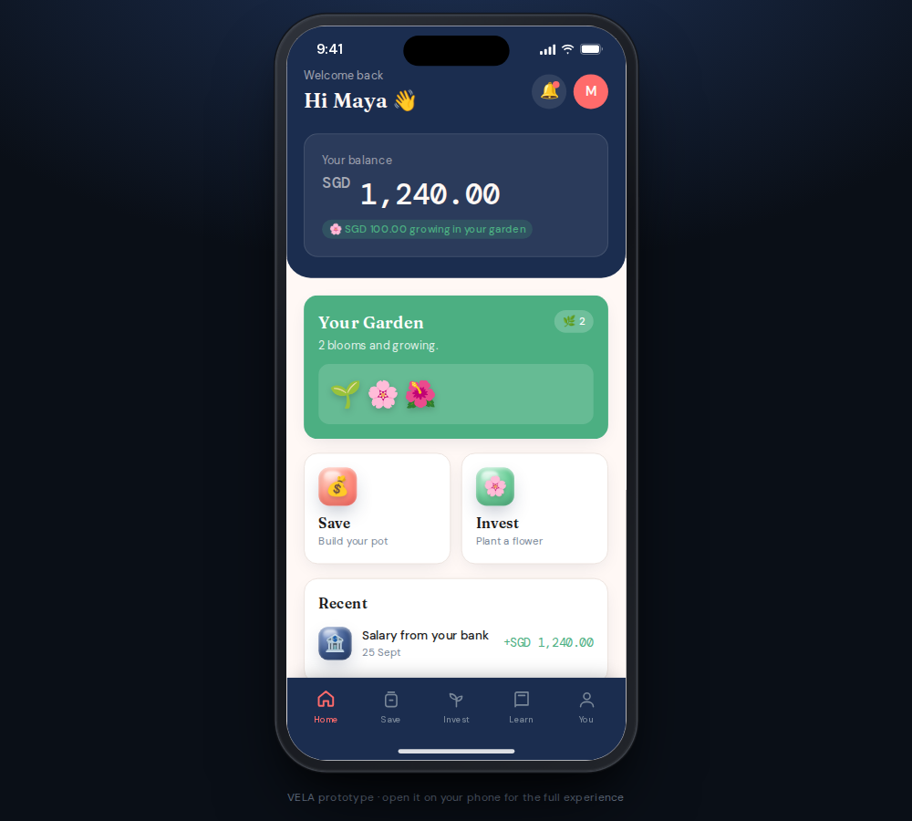
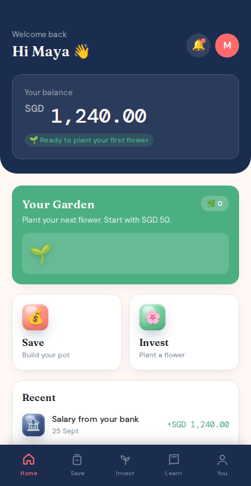
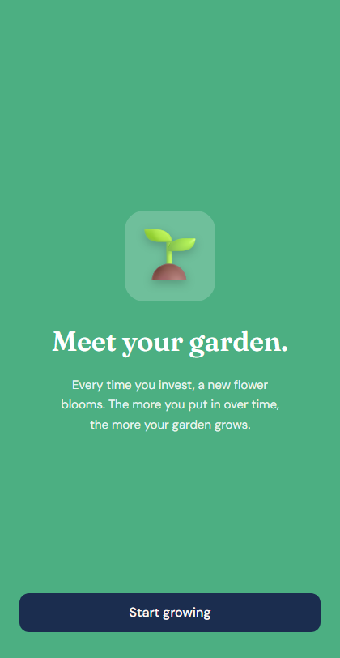

# VELA

*Your money, moving.*

A mobile banking and investing prototype for people earning their first salary. It is a product
case study: a working app, and a record of the decisions behind it.

**Live demo: https://amirthanvenkat.github.io/vela-v1/**

Open the link on your phone for the intended experience. On a laptop it opens inside a phone
frame. It can be added to your home screen and works offline after the first visit. All the money
in it is pretend.



| Home | First investment | Your garden |
|---|---|---|
|  |  |  |

## The problem

The design persona is Maya, 23, three months into her first job in Singapore. She has a little
money left at the end of each month. Her parents never talked about investing, and the finance
apps she has tried felt built for traders.

She wants three things: to put a little aside, to let some of it grow, and to understand what is
happening without a dictionary. VELA is built around that. Maya is a design persona, not a real
user, and [her story](docs/user-story-maya.md) walks through the app screen by screen.

## What VELA does

- **Starts with one question.** A tortoise, a fox or a rocket, in place of a risk questionnaire.
- **Shows a garden, not a chart.** Each investment plants a flower that grows over three days.
- **Saves towards a named goal,** with a date if you want one.
- **Lets you take money out** in two taps, and shows what will change before you confirm.
- **Says what your money is in:** a mix of shares and bonds, each explained in one plain line.
- **Teaches in short reads,** placed on the screens where the question comes up.

## Three decisions that shaped it

The roadmap followed one rule: make the prototype credible before making it clever. These are the
three calls that mattered most.

**1. The garden grows by time, not by market prices.**
A simulated market, where the garden wilts on a bad week, would have been more engaging. It would
also teach beginners to check daily and sell in a panic. Flowers grow with the habit of planting,
so a bad week cannot wilt them and no made-up return is ever shown.

**2. The app tells you when not to invest.**
If a goal is less than three years away, VELA suggests keeping that money in savings. For a goal
further off it suggests a monthly amount, worked out without assuming any growth, so it errs
towards saving more. Every tip says it is a guide, not advice.

**3. Promises in the copy are treated as features owed.**
"Take your money out whenever you want" appeared on four screens for six rounds before there was
any way to do it. A review of what the app promised but did not do found that, and found that the
risk choice changed nothing. Both were fixed before anything new was built.

The [prioritisation log](docs/prioritisation.md) covers all nine pull requests: the options
weighed in each round, what was left out, and where RICE, MoSCoW and Kano each helped or fell
short.

## What I would do differently

1. **Audit promises at the start of every round.** The backlog was written as "features to add",
   not "promises to keep", which is how withdrawals went missing.
2. **Budget foundation work in the open.** The build system, routing and offline support score low
   on RICE and still made every later round cheaper and safer.
3. **Test with real users sooner.** Five rounds shipped before anyone in the target group tried it.

## What is not proven yet

No first-salary user has been observed using VELA. Every impact score in the log is an estimate.

The [usability session kit](docs/research-plan.md) is written: five sessions, six tasks, and pass
marks fixed in advance. Findings will be added here once the sessions have run.

## How it was built, and my role

I was the product owner. I set the direction, chose between the options in each round, and
approved every merge.

The app was built with an AI coding partner (Claude Code), which proposed options, wrote the code
and tests, and opened each pull request. It is a Vite and React app with 48 unit tests and 28
end-to-end tests, and every pull request runs them before it can deploy.

## Read more

| Document | What it covers |
|---|---|
| [Maya's user story](docs/user-story-maya.md) | The app screen by screen, from a first-salary user's point of view |
| [How the roadmap was prioritised](docs/prioritisation.md) | The decision log for every round, with RICE, MoSCoW and Kano |
| [Usability session kit](docs/research-plan.md) | The plan for testing VELA with five first-salary users |
| [Development notes](docs/development.md) | Running, testing and deploying, the code layout, flows and design notes |

## Run it locally

You need Node.js 20 or newer.

```bash
npm install
npm run dev        # http://localhost:5777/
```

Before committing, run `npm run lint` and `npm test`. The full list of commands, the code layout
and the design notes are in the [development notes](docs/development.md).
